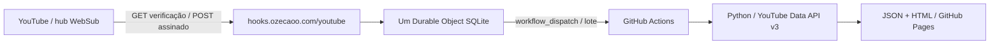

# YouTube WebSub → Worker → GitHub Actions

Camada serverless para um único canal. O Worker autentica notificações e agenda o workflow existente; **o Python continua sendo responsável por consultar a API v3, selecionar os dois vídeos e construir o site**. Nenhuma chamada autenticada é feita pelo navegador. O site permanece no GitHub Pages.



## Estrutura e estado

- `src/index.ts`: limites HTTP, autenticação HMAC e administrativa, roteamento e Cron.
- `src/websub.ts`: protocolo, XML namespace-aware, fingerprints e pedido de inscrição.
- `src/coordinator.ts`: persistência transacional, lease, deduplicação, batching e dispatch.
- `src/types.ts`: configuração, limites e logs estruturados permitidos.
- `test/`: testes determinísticos sem notificações reais, recursos remotos ou tokens válidos.
- `tools/configure_secrets.py`: entrada oculta no terminal, três secrets locais, permissão 0600.
- `tools/cloudflare_preflight.py`: inspeção read-only com OAuth do Wrangler, sem imprimir o token.
- `tools/admin.py`: status, inscrição, cancelamento, manutenção e teste explicitamente controlado.
- `tools/tail_safe.py`: lê o tail e imprime só campos estruturados permitidos, descartando URL/headers/corpo.

O Durable Object guarda somente fingerprints e metadados de eventos, fila pendente, lotes, histórico limitado e estado da assinatura. Não há KV, D1, Queues, conexões permanentes ou duplicação da captura do Python. Um objeto nomeado pelo Channel ID fornece consistência e transações; KV eventual sozinho não impediria duas entregas simultâneas de dispararem duas execuções. A opção SQLite Free foi aprovada pelo responsável.

## Ferramentas, autenticação e secrets

Node.js 24 e npm são usados nesta instalação. O Wrangler está fixado no lockfile; `saxes` é a dependência de runtime para interpretar XML com namespaces sem DTD/entidades externas.

Na raiz do repositório:

```bash
npm --prefix workers/youtube-webhook ci
npm --prefix workers/youtube-webhook run check
npm --prefix workers/youtube-webhook run dry-run
```

Na pasta `workers/youtube-webhook`, autentique com `npx wrangler login` e confirme com `npx wrangler whoami`. O login dá acesso à conta existente; não cria outra conta. `npm run preflight` consulta conta/zona, rotas, domínio e disponibilidade do script. Se uma leitura não for permitida pelo OAuth, o relatório registra somente seu HTTP status. Nunca imprime o token.

Secrets:

| Secret | Uso |
| --- | --- |
| `GITHUB_TOKEN` | Fine-grained PAT, proprietário `vlopcas`, somente repo `oZECAOo`, Actions: Read and write; Metadata: Read é automático. |
| `WEBSUB_SECRET` | HMAC do hub, gerado aleatoriamente pelo helper. |
| `ADMIN_TOKEN` | Bearer independente dos endpoints administrativos, gerado pelo helper. |

Crie o PAT em [GitHub → Fine-grained personal access tokens](https://github.com/settings/personal-access-tokens/new). Não precisa Contents: write, OAuth, token clássico ou acesso a outros repositórios. O prazo de expiração é o escolhido na criação: a renovação automática da assinatura WebSub não renova um PAT expirado. Para trocar o PAT, execute o helper novamente: ele mantém os secrets HMAC/admin existentes.

```bash
npm --prefix workers/youtube-webhook run configure-secrets
```

O token é digitado no terminal sem eco. O helper cria `.secrets.local.json`, ignorado pelo Git e com permissão 0600. Não cole tokens no chat, em argumentos, exemplos ou documentação. Não use `.env` versionado. O arquivo JSON privado é utilizado apenas por `wrangler deploy --secrets-file`; secrets não são constantes do bundle. Faça backup seguro dos secrets administrativos, pois a Cloudflare não devolve seus valores.

## Publicação autorizada

**Commit, push, primeiro deploy e testes reais exigem autorização explícita do responsável.** Preparar arquivos, instalar dependências, autenticar e executar testes locais/dry-run não publica o serviço.

Configuração preparada:

- Worker `ozecaoo-youtube-webhook` na conta existente.
- Custom Domain exato `hooks.ozecaoo.com`; callback `https://hooks.ozecaoo.com/youtube`.
- Um DO `ChannelCoordinator`, migration SQLite `v1`.
- Cron de manutenção `23 */6 * * *` em UTC.
- `DISPATCH_ENABLED=false` durante a preparação; a instalação autorizada está com `true`. Nenhuma chamada ao GitHub é feita com o gate fechado.
- Inscrição inicialmente desativada; o Cron não solicita uma assinatura até o comando administrativo `subscribe`.

Antes da publicação, o preflight conferiu zona ativa, ausência de domínio/rotas de Worker conflitantes e inexistência desse script. O OAuth não permitiu listar registros DNS internos (HTTP 403); a resolução pública de A/AAAA/CNAME para `hooks` retornou NXDOMAIN. O deploy não deve forçar remoção/substituição de um registro conflitante se o Wrangler encontrar algum. Apex, `www`, Pages e outros DNS ficam fora do escopo. Nenhum registro foi alterado na preparação.

Após autorização, na pasta do Worker:

```bash
npm run deploy
python3 tools/admin.py status
python3 tools/admin.py subscribe
```

O deploy cria somente o hostname dedicado, certificado e recursos declarados. Depois de conferir saúde, secrets e assinatura, habilite `DISPATCH_ENABLED=true` no arquivo de configuração e publique a versão habilitada, dentro da autorização concedida. `npm run deploy` também serve para futuras atualizações; nenhuma rotina de CI faz deploy automático do Worker.

Se houver impedimento demonstrável ao Custom Domain, configure um hostname `workers.dev`, ajuste `CALLBACK_URL` e a inscrição. Não altere o tópico, nem migre o site. A mudança de callback exige uma nova inscrição e cancelamento da antiga.

## Protocolo e segurança

O tópico WebSub é o endereço documentado pelo YouTube, com `/xml` e o Channel ID:

`https://www.youtube.com/xml/feeds/videos.xml?channel_id=UCkS1cj-1C9ahgYVvFGz86qw`

Ele difere do Atom de polling usado pelo Python. Não remover a query por seguir cegamente um `rel=self` incompleto. O hub HTTPS fixo é `https://pubsubhubbub.appspot.com/`. Pedidos incluem modo, tópico, callback, HMAC secret, `hub.verify=async`, token aleatório de verificação e lease solicitado de dez dias. O prazo real recebido no desafio é a referência. ACK 2xx não significa assinatura ativa.

GET de verificação exige tópico/modo corretos, parâmetros válidos e nonce de um pedido pendente por até dez minutos. Responde somente o challenge, com `nosniff` e sem cache. Retransmissão do mesmo desafio é idempotente e não estende o lease. A inscrição real de 4 de novembro de 2026 confirmou o tópico, `hub.verify_token` e lease de dez dias; os testes simulados continuam cobrindo falhas e renovação.

POST exige `X-Hub-Signature` válido, HMAC-SHA1 (compatibilidade Google) ou SHA256 sobre os bytes originais. Sem assinatura não há fila nem disparo. XML passa por limite de 64 KiB, namespaces Atom/YouTube exatos, limite de profundidade/entradas/campos, rejeição de DTD/ENTITY e validação de canal/IDs/datas. Não se consulta nenhuma URL indicada pelo XML. Tombstones explícitos são ignorados e a reconciliação periódica cuida de disponibilidade.

O evento é persistido antes do ACK; falha de armazenamento retorna 503 para permitir reentrega. O recebimento não espera um Actions terminar. A fila utiliza um alarme durável, em vez de depender de `waitUntil` para conservar uma notificação. O Cron usa `waitUntil` somente para solicitar a manutenção do objeto.

Endpoints administrativos exigem `Authorization: Bearer <ADMIN_TOKEN>`. Sem credencial, status interno, reinscrição, cancelamento, manutenção e teste ficam indisponíveis. Logs estruturados contêm somente razões seguras, IDs públicos, timestamps, contagens, leases e resultados HTTP. Logs automáticos de invocação estão desativados para não registrar query de verificação. Nunca registrar headers, XML completo, secrets ou assinaturas.

## Deduplicação e economia

- Fingerprint semântico: canal, vídeo, título e publicação. Mudanças apenas em descrição, envelope ou `updated` não criam nova versão.
- Até 2.000 versões conhecidas e 200 vídeos pendentes, com persistência transacional. Falta de espaço/armazenamento gera erro em vez de ACK com perda.
- Debounce de 30 segundos; versões novas de um mesmo vídeo substituem sua versão pendente sem apagar outros vídeos.
- Cooldown de dois minutos e até doze disparos por hora. O excedente é adiado, não descartado. Um lote reúne até cinquenta IDs.
- Execução GitHub já ativa adia os eventos automáticos, sem cancelar workflows em andamento. Um teste administrativo explicitamente autorizado pode entrar na fila mesmo assim; a concorrência `pages` do GitHub continua serializando a publicação. Fontes de teste controlado e WebSub permanecem separadas.
- Edições de metadados que já estejam refletidas nos cards ou não afetem os dois vídeos visíveis podem ser ignoradas por comparação best-effort com o JSON público. Sem referência válida, o evento é mantido.
- Cada lote tem UUID persistente no input e `run-name` do workflow. Uma intenção de envio é salva antes da chamada externa.

O dispatch usa `workflow_dispatch` no `deploy.yml`, branch `main`; o token só precisa de Actions: write. São aceitos HTTP 200 ou 204. Erros de autenticação bloqueiam tentativas em loop até manutenção/credencial corrigida; rede, 429/5xx e limites de taxa têm retries duráveis com backoff. Em resposta ambígua, consulta runs pelo batch ID e espera propagação antes de repetir.

Não é possível prometer exactly-once absoluto entre armazenamento da Cloudflare e uma API externa: uma resposta perdida após aceitação pode permanecer ambígua. O outbox, a consulta ao GitHub e os limites reduzem esse risco; não se marca entregue antes de confirmação. O UUID permite investigar eventuais duplicatas.

A consulta de recuperação lê os dez runs mais recentes, com resposta limitada a 512 KB durante a leitura. Muitos disparos externos podem encobrir um lote ambíguo nessa janela. Respostas inválidas ou grandes demais preservam o lote e usam retry, sem liberar um disparo às cegas. Requests autenticados usam redirecionamento manual, sem encaminhar a credencial a outro destino.

## Renovação, saúde e recuperação

Após confirmação, o objeto guarda expiração e agenda renovação em aproximadamente 75% do lease. O Cron verifica estado/assinatura perdida; não renova em toda chamada se ainda não for necessário. Falhas e desafios expirados usam backoff. Cancelar desativa eventos e renovação, inclusive antes da confirmação final de unsubscribe.

```bash
python3 tools/admin.py status
python3 tools/admin.py maintenance
python3 tools/admin.py subscribe
python3 tools/admin.py unsubscribe
python3 tools/tail_safe.py --duration 120
```

Reinscrição manual autenticada serve para recuperar estado perdido. Após corrigir token ou configuração, `maintenance` remove o bloqueio e tenta os pendentes. `status` informa enabled/active/lease/renovação, contagens e razões, sem revelar nonce ou secrets. `/health` é público e mínimo. Não exponha o arquivo local de secrets ao usar essas ferramentas. Prefira o helper de tail ao JSON bruto do Wrangler: metadados automáticos de requisição podem conter parâmetros de verificação ou cabeçalhos que não devem ser registrados.

Para desativar: execute `unsubscribe`, mantenha `DISPATCH_ENABLED=false` e publique a configuração autorizada. O site continua funcionando pelo cron/manual do GitHub. Os quatro horários atuais do GitHub foram mantidos; a redução para dois exige observar notificações reais e avaliar a cobertura de lives. A reversão não depende de mover o domínio ou modificar Pages.

## Testes reais e evidências

Os testes automatizados são simulados e não fazem POST no hub ou dispatch real. Depois da autorização, verificar separadamente:

1. Worker HTTPS, Custom Domain, secrets, Cron e logs seguros.
2. Pedido real, callback GET verificado, `active=true`, expiração e renovação registrados.
3. Teste administrativo controlado, com IDs reais do site atual:

   ```bash
   python3 tools/admin.py test-dispatch --confirm-real-dispatch
   ```

4. Lote visível no `run-name`, input `websub_test`, sincronização API v3 `UPDATED`, build/deploy e mesmos IDs no site.
5. Notificação espontânea autenticada do hub, se ocorrer. Teste administrativo ou POST sintético assinado localmente **não** demonstra entrega real do YouTube.

O Step Summary diferencia `schedule`, `manual`, `websub` e `websub_test`. IDs anunciados são contexto: nunca alteram a seleção validada pelo Python. O workflow continua funcionando por agendamento e pelo botão Run workflow.

O YouTube documenta upload e alterações de título/descrição. Não garante notificar início/fim de live ou momento exato de disponibilização da gravação. Não há promessa de atualização instantânea desses estados. Por isso, manter a reconciliação a cada seis horas é prudente para esse canal; reduzir para duas execuções diárias pode deixar gravações de lives até doze horas sem descoberta. Monitoramento dedicado de AO VIVO é uma evolução separada.

| Situação | Cobertura e comportamento |
| --- | --- |
| Novo upload | Evento documentado pelo YouTube; o Worker agenda a consulta e a API confirma a elegibilidade. |
| Vídeo publicado | Uploads públicos podem atualizar o site por evento; não há garantia documentada para toda transição de privacidade/publicação. A reconciliação cobre ausências. |
| Título/descrição alterados | Ambos são documentados; mudanças apenas na descrição não disparam rebuild, pois os cards não a exibem. |
| Live agendada | Pode gerar entrada no feed, sem garantia específica. O Python exclui conteúdo ainda indisponível. |
| Live iniciada | WebSub não garante esse sinal; o site não é um indicador de AO VIVO. |
| Live encerrada | WebSub não garante esse sinal; a reconciliação consulta o estado na API. |
| Gravação disponibilizada | A API valida a gravação disponível. Sem evento, a descoberta aguarda reconciliação ou execução manual. |

Resultados da instalação e links de execuções: [validação de 4 de novembro de 2026](../../docs/websub-validation-2026-11-04.md).

## Custos e limites

Compatível com Workers Free: 100 mil requisições/dia, 10 ms de CPU por invocação HTTP/Cron, 50 subrequests e até cinco Cron Triggers por conta. DO SQLite Free: 100 mil requisições/dia (inclui alarmes), 13 mil GB-s/dia, 5 GB de armazenamento, cinco milhões de linhas lidas e cem mil escritas por dia. Esses limites são compartilhados com outros usos da conta. Excesso no Free falha; não ativa automaticamente um plano pago. Nenhum plano pago foi habilitado na instalação.

Referências oficiais: [YouTube WebSub](https://developers.google.com/youtube/data/guides/push_notifications), [hub Google](https://pubsubhubbub.appspot.com/), [HMAC PubSubHubbub 0.4](https://pubsubhubbub.github.io/PubSubHubbub/pubsubhubbub-core-0.4.html#authednotify), [WebSub](https://www.w3.org/TR/websub/), [KV e consistência eventual](https://developers.cloudflare.com/kv/concepts/how-kv-works/), [DO pricing](https://developers.cloudflare.com/durable-objects/platform/pricing/), [Workers limits](https://developers.cloudflare.com/workers/platform/limits/), [Custom Domains](https://developers.cloudflare.com/workers/configuration/routing/custom-domains/), [workflow_dispatch e token](https://docs.github.com/en/rest/actions/workflows#create-a-workflow-dispatch-event).
